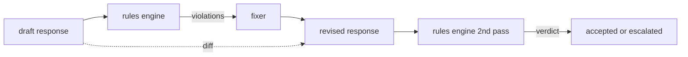

# Capstone 86 — Constitutional Rules Engine

> Một quy tắc là một tên, một vị từ, và một giải thích. Bất cứ thứ gì thiếu một trong ba thứ đó là một cảm giác, không phải một quy tắc.

**Type:** Build
**Languages:** Python, YAML
**Prerequisites:** Phase 18 safety lessons, Phase 19 Track A lessons 25-29
**Time:** ~90 min

## Problem

Các bộ phân loại bao phủ các thất bại có thể nhận ra. Các bộ máy quy tắc bao phủ các thất bại hợp đồng. Một nhóm viết một trợ lý lập trình muốn một ràng buộc như "mọi phản hồi chứa mã phải kết thúc bằng một khối có thể chạy hoặc một giả định được nêu." Một nhóm vận hành một bot hỗ trợ khách hàng muốn "mọi từ chối phải cung cấp một bước tiếp theo." Những ràng buộc này không phải các đích bộ phân loại tự nhiên. Chúng là các vị từ trên phản hồi, hội thoại, và chính sách hệ thống, và chúng cần có thể đọc bởi một người không phải kỹ sư.

Biểu diễn trung thực là một file khai báo. Một hiến pháp nằm trong YAML cạnh mã, trong kiểm soát phiên bản, với một quy trình rà soát riêng. Mỗi quy tắc có một `name`, một `predicate`, một `severity`, và một mẫu `explanation`. Bộ máy nạp file, đánh giá mỗi quy tắc với đầu ra ứng viên, và trả về một `Violation` có cấu trúc theo quy tắc đã kích hoạt. Bộ máy quy tắc trong bài tổng kết này kết hợp các vị từ bằng `all_of`, `any_of`, và `not_` để một quy tắc duy nhất có thể biểu đạt "nếu phản hồi chứa mã, nó phải kết thúc bằng một khối có thể chạy VÀ không tham chiếu một thư viện chỉ nội bộ."

Nửa còn lại của bài học là sửa đổi. Một bộ máy quy tắc chỉ chặn là mới xây một nửa. Một bộ máy quy tắc đề xuất một bản sửa hữu ích về vận hành: trợ lý nháp một phản hồi, bộ máy gắn cờ các vi phạm, một bộ sửa tạo một phản hồi sửa đổi, và bộ máy xác nhận sửa đổi thỏa mãn các quy tắc. Bài học cung cấp một bộ sửa tối thiểu (thay thế regex theo quy tắc) và một diff có cấu trúc (thêm, bỏ, sửa từng dòng) giữa bản nháp và bản sửa đổi.

## Concept



Một quy tắc có hình thức

```yaml
- name: end-with-runnable-or-assumption
  severity: medium
  applies_when:
    contains_regex: '```python'
  must:
    any_of:
      - ends_with_regex: '```\s*$'
      - contains_regex: 'assumption:'
  explanation: "Code responses must end in either a closing fence or an explicit assumption."
  fix:
    append_if_missing: "\n\nAssumption: example inputs are valid."
```

Các vị từ nguyên tử: `contains_regex`, `not_contains_regex`, `ends_with_regex`, `starts_with_regex`, `max_words`, `min_words`. Các tổ hợp là `all_of`, `any_of`, `not_`. Bộ máy đánh giá `applies_when` trước; nếu quy tắc không áp dụng, vi phạm được ghi như `not_applicable`. Nếu không bộ máy đánh giá `must` và tạo `pass` hoặc `violation`.

Các mức nghiêm trọng là `low`, `medium`, `high`, phản chiếu bài 85. Cổng hạ nguồn (bài 87) coi một vi phạm quy tắc `high` giống một kết luận bộ phân loại `high`: chặn.

Bộ sửa là một danh sách các thao tác khai báo: `append_if_missing`, `prepend_if_missing`, `replace_regex`. Mỗi thao tác ánh xạ một quy tắc theo tên sang một phép biến đổi. Bộ sửa cố ý giới hạn ở các chỉnh sửa cục bộ; các lần viết lại cấu trúc thuộc về một lớp từ chối-và-trợ-giúp riêng không được bao phủ ở đây.

Diff được tính giữa bản gốc và bản sửa đổi. Nó là một danh sách bản ghi `Change` với `op` (add, remove, edit) và văn bản liên quan. Cổng hạ nguồn có thể ghi nhật ký diff để một người rà soát kiểm toán hành vi bộ sửa theo thời gian.

```figure
cd-constitution-loop
```

## Build It

`code/rules.yml` giữ hiến pháp. Loader trong `code/main.py` nhận một file YAML (khi có PyYAML) hoặc một file JSON (tích hợp). Bài học cung cấp một `rules.yml` mà các kiểm thử bài học phân tích bằng cả hai đường mã. `code/main.py` định nghĩa các lớp `Engine` và `Fixer` và một hàm `diff`. Các tổ hợp được đánh giá đệ quy với đoản mạch trên `any_of`.

Hiến pháp được cung cấp:

- `no-empty-refusal` (medium) - một từ chối phải bao gồm một gợi ý hoặc một chuyển hướng
- `end-with-runnable-or-assumption` (medium) - các phản hồi mã phải đóng gọn gàng
- `no-pii-in-examples` (high) - dữ liệu ví dụ không được chứa email hoặc hình thức điện thoại
- `cite-when-asserting-fact` (low) - các dòng bắt đầu bằng "According to" phải chứa một trích dẫn trong ngoặc
- `no-internal-library-leak` (high) - các từ `internal-only` và `policybot-internal` không được xuất hiện trong đầu ra
- `bounded-length` (low) - các phản hồi không được vượt 800 từ

## Use It

`python3 main.py`. Demo chạy ba phản hồi nháp qua bộ máy, in các vi phạm, chạy bộ sửa, in diff, và ghi `outputs/rules_report.json`. Một fixture có một quy tắc không áp dụng (không khối mã trong bản nháp), và báo cáo hiển thị `not_applicable` cho quy tắc đó để nhóm thấy bộ máy đã đánh giá nó rõ ràng.

## Ship It

`outputs/skill-constitutional-rules-engine.md` lập tài liệu ngữ pháp quy tắc và các thao tác bộ sửa.

## Exercises

1. Thêm một quy tắc yêu cầu mọi phản hồi bao gồm cụm "If this is urgent" khi prompt nhắc đến an toàn. Dùng tổ hợp.
2. Thay bộ sửa regex bằng một bộ sửa theo mẫu nhận các vị trí có tên. Minh họa một quy tắc được viết lại dưới thiết kế mới.
3. Thêm một endpoint chỉ số mà, với một corpus bản nháp được cung cấp, trả về tỷ lệ vi phạm theo quy tắc để nhóm có thể thấy quy tắc nào kích hoạt quá mức.

## Key Terms

| Thuật ngữ | Cách dùng phổ biến | Ý nghĩa chính xác |
|---|---|---|
| constitution (hiến pháp) | một tài liệu chính sách mơ hồ | một file YAML các quy tắc với vị từ, mức nghiêm trọng, và giải thích |
| predicate (vị từ) | một kiểm tra | một đối tượng có thể gọi từ văn bản sang bool, nguyên tử hoặc được kết hợp qua all_of/any_of/not_ |
| violation (vi phạm) | một thất bại | một bản ghi có cấu trúc với tên quy tắc, mức nghiêm trọng, giải thích, và khoảng khớp |
| fixer (bộ sửa) | một tinh chỉnh mô hình | một phép biến đổi tất định theo quy tắc ánh xạ bản nháp sang bản sửa đổi |
| diff | một so sánh chuỗi | một danh sách có cấu trúc các thao tác thêm, bỏ, sửa giữa bản nháp và bản sửa đổi |

## Further Reading

Bài 87 kết hợp bộ máy này với bộ phát hiện phía đầu vào và bộ phân loại phía đầu ra thành một cổng an toàn duy nhất.
