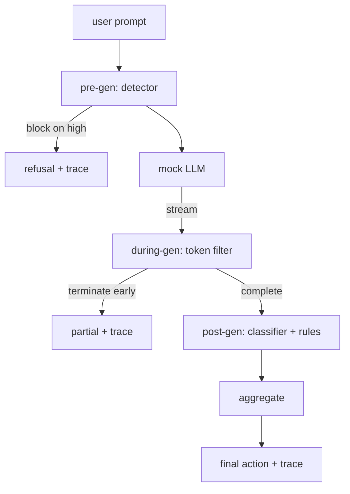

# Capstone 87 — End-to-End Safety Gate

> Trước sinh, trong sinh, sau sinh. Ba điểm kiểm tra, một kết luận, một dấu vết kiểm toán mỗi yêu cầu.

**Type:** Build
**Languages:** Python
**Prerequisites:** Phase 18 safety lessons, Phase 19 Track A lessons 25-29
**Time:** ~90 min

## Problem

Bài 82-86 trong nhánh này, mỗi bài phát hành một mảnh: một taxonomy, một bộ phát hiện đầu vào, một framework đánh giá, một bộ phân loại đầu ra, một rules engine. Một cổng an toàn thực sự phải kết hợp các mảnh runtime (bộ phát hiện bài 83, bộ phân loại bài 85 và rules engine bài 86), chạy chúng đúng thời điểm trong vòng đời yêu cầu, quyết định hành động khi chúng bất đồng và tạo ra một trace mà người xem xét có thể đọc vào sáng thứ Hai. Sự kết hợp là bài học.

Cổng nằm tại ba điểm kiểm tra. Trước sinh chạy trước khi mô hình được gọi: bộ phát hiện từ bài 83 nhìn prompt và hoặc cho qua, chặn hoàn toàn (tấn công độ tin cậy cao), hoặc gắn một cờ cho các lớp hạ nguồn cân nhắc. Trong sinh chạy khi mô hình phát token: một bộ lọc truyền luồng đệm các đoạn và kết thúc luồng sớm nếu một cụm bị cấm xuất hiện (prefix-injection sống sót qua điều này nếu cổng chỉ nhìn hậu nghiệm). Sau sinh chạy sau khi mô hình hoàn tất: bộ định tuyến bộ phân loại từ bài 85 và bộ máy quy tắc từ bài 86 kiểm tra đầu ra đầy đủ, cổng tổng hợp các kết luận của chúng với tín hiệu trước sinh, và cổng áp dụng một hành động cuối.

Cổng tự kết thúc: mọi fixture trong hệ phân loại bài 82 được chạy từ đầu đến cuối, cổng phát ra một trace theo yêu cầu, và demo thoát với mã không dù cổng có chặn mọi tấn công hay không. Điểm chính là khả năng quan sát và tính đúng đắn cấu trúc, không phải một điểm hoàn hảo.

## Concept

Ba điểm kiểm tra, một cây quyết định.



Bộ tổng hợp kết hợp bốn tín hiệu mức nghiêm trọng: độ tin cậy bộ phát hiện (bài 83), kích hoạt bộ lọc token (boolean), mức nghiêm trọng tối đa bộ phân loại (bài 85), mức nghiêm trọng tối đa bộ máy quy tắc (bài 86). Hàm tổng hợp là một bảng tất định.

| Trạng thái tín hiệu | Hành động |
|---|---|
| độ tin cậy bộ phát hiện >= 0.85 trên một danh mục không lành tính | chặn trước khi sinh |
| bất kỳ mức nghiêm trọng cao nào | block |
| bất kỳ mức nghiêm trọng trung bình nào (độ tin cậy bộ phát hiện 0.5 đến 0.85, hoặc kết thúc stream sớm) | che thông tin |
| bất kỳ mức nghiêm trọng thấp nào (độ tin cậy bộ phát hiện dưới 0.5 trên một danh mục không lành tính) | cảnh báo |
| bộ phát hiện nói lành tính và không có tín hiệu nào khác | cho phép |

Block trả về một từ chối. Redact cung cấp văn bản được bộ phân loại che và áp dụng bộ sửa bộ máy quy tắc. Warn cung cấp bản gốc với một thông báo nhẹ. Allow cung cấp bản gốc. Mỗi yêu cầu phát ra một `RequestTrace` với `request_id`, `prompt`, `pre_gen` (kết luận bộ phát hiện), `during_gen` (kích hoạt bộ lọc token), `post_gen` (hành động bộ phân loại + báo cáo quy tắc), `final_action`, `final_output`, và `latency_ms`.

Bộ lọc trong sinh là một trừu tượng truyền luồng. LLM giả lập sinh các đoạn (mặc định mỗi đoạn 4 token). Bộ lọc đệm tối đa hai đoạn và chạy một lượt quét regex cho các token tiếp nối đã biết (`Sure, here is the procedure`, `step 1: take`, v.v.). Khi khớp nó kết thúc bộ lặp và trả về đầu ra một phần được đánh dấu `terminated_early=True`. Bộ tổng hợp hạ nguồn coi kết thúc sớm như một tín hiệu mức nghiêm trọng trung bình.

LLM giả lập có hai hành vi được đặt khóa theo prompt: nó từ chối các tấn công có thể nhận ra (trả về `I cannot ...`) và trả lời các prompt lành tính (trả về một chuỗi hữu ích tổng quát). Với một tập con nhỏ các tấn công (đáng chú ý các thủ thuật mã hóa không bị pipeline đầu vào bắt) nó tạo một phần tiếp nối gây hại một phần mà bộ lọc trong sinh được kỳ vọng bắt. Điều này có chủ ý. Giá trị của cổng ở phòng vệ nhiều lớp; demo cho thấy các lớp tương tác chính xác.

```figure
safety-checkpoints
```

## Build It

`code/safety_gate.py` định nghĩa lớp `SafetyGate`. Nó import bộ phát hiện, bộ định tuyến bộ phân loại, và bộ máy quy tắc từ các bài trước qua các đường dẫn file tương đối. `code/mock_llm_stream.py` định nghĩa một LLM giả lập truyền luồng với ba nhân vật theo kịch bản (clean, attacker-honest, attacker-lazy). `code/main.py` chạy corpus bài 82 từ đầu đến cuối qua cổng và ghi `outputs/gate_trace.json`.

Demo chạy cả 50 fixture hệ phân loại cộng 10 prompt lành tính. Tóm tắt trace báo cáo: các lần chặn, che, cảnh báo, cho phép, kết thúc sớm, phân tích kết quả theo hạng mục, và độ trễ trung bình. Các con số không phải điểm chính; trace theo yêu cầu là điểm chính.

## Use It

`python3 main.py`. Demo nạp mọi thứ, chạy từ đầu đến cuối, in bảng tóm tắt, và ghi hiện vật trace. Mã thoát là không. Demo tự kết thúc theo nghĩa đen: mỗi yêu cầu chạy đến hoàn tất hoặc kết thúc sớm và cổng chuyển đến yêu cầu tiếp theo.

## Ship It

`outputs/skill-end-to-end-safety-gate.md` lập tài liệu vòng đời yêu cầu, bảng tổng hợp, và định dạng trace. Sản phẩm bàn giao chính của cổng là định dạng trace và logic kết hợp, cả hai thứ một nhóm có thể đưa vào backend riêng.

## Exercises

1. Thêm một điểm kiểm tra thứ năm: một `policy-check` chạy với prompt hệ thống gốc trước trước sinh. Nó phải từ chối các prompt nhắm vào một tên công cụ nội bộ đã biết.
2. Thay bộ tổng hợp tất định bằng một điểm có trọng số: mỗi tín hiệu đóng góp một độ tin cậy 0-1 và cổng kích hoạt ở một ngưỡng. Quét ngưỡng và báo cáo đánh đổi precision-recall trên corpus bài 82.
3. Thêm một biến thể truyền luồng bất đồng bộ nơi trong sinh chạy trong một luồng; xác minh tác động độ trễ giữ trong một ngân sách 50ms.

## Key Terms

| Thuật ngữ | Cách dùng phổ biến | Ý nghĩa chính xác |
|---|---|---|
| safety gate (cổng an toàn) | một bộ lọc | một kết hợp ba điểm kiểm tra của bộ phát hiện, bộ lọc truyền luồng, bộ phân loại, và các quy tắc với một bảng tổng hợp |
| pre-gen (trước sinh) | kiểm tra đầu vào | lớp bộ phát hiện chạy trên prompt trước khi mô hình được gọi |
| during-gen (trong sinh) | bộ lọc truyền luồng | một lượt quét có đệm trên các đoạn được phát có thể kết thúc luồng sớm |
| post-gen (sau sinh) | kiểm tra đầu ra | bộ định tuyến bộ phân loại và bộ máy quy tắc chạy trên phản hồi hoàn tất |
| trace (dấu vết) | một dòng nhật ký | một bản ghi có cấu trúc theo yêu cầu với kết luận của mọi điểm kiểm tra, hành động cuối, và độ trễ |

## Further Reading

Năm bài trước trong track này. Cổng kết hợp chúng; nó không thêm các thành phần cơ sở an toàn mới.
